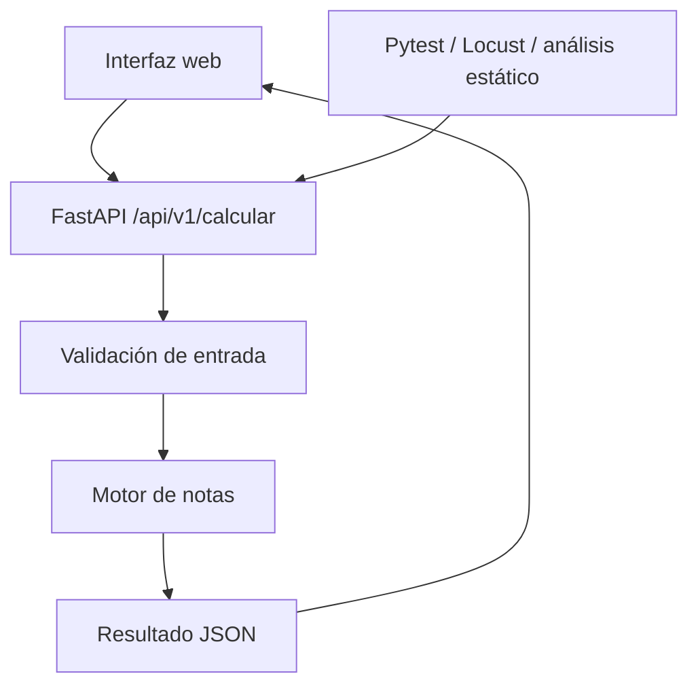

# SIGEN Lite — Guía integral del proyecto final

**Asignatura:** Pruebas y Mantenimiento de Software

**Tipo de entrega:** Aplicación web pequeña + API REST + evidencias de aseguramiento de calidad

**Estado de este documento:** Especificación y plan de implementación. **No** representa una aplicación ya desarrollada ni pruebas ya ejecutadas.

**Alcance:** Prototipo académico demostrable, con datos ficticios y sin cuentas, base de datos ni integración institucional.

**Revisión:** 10 de noviembre de 2026. Esta versión fija el contrato inicial y corrige los acuerdos de tipos, errores, instalación, cobertura e integración continua. El repositorio comienza con documentación; los archivos de código y los comandos de aplicación descritos aquí son trabajo pendiente.

---

## 1. Presentación del proyecto

**Nombre:** SIGEN Lite — Sistema de Gestión y Evaluación de Notas Universitarias.

**Descripción corta:** SIGEN Lite es una aplicación web que recibe calificaciones y porcentajes de evaluación, verifica que sean válidos, calcula la nota definitiva de una asignatura y muestra el resultado académico. Su propósito principal en esta asignatura es demostrar cómo se diseñan, automatizan, ejecutan y mantienen pruebas de software sobre una aplicación con reglas de negocio reales.

### 1.1 Caso de estudio y justificación

Una persona docente puede cometer errores al ingresar notas, asignar ponderaciones o calcular un promedio final. Esos errores afectan la confianza en el resultado académico. SIGEN Lite centraliza las reglas de validación y cálculo y ofrece un caso comprobable para estudiar fallos, valores límite, contratos de API, carga y mantenimiento.

**Referencia normativa utilizada para el caso:** Reglamento Académico de Pregrado de la Universidad Cooperativa de Colombia, **Acuerdo Superior 381 de 2018, artículo 38**, que describe calificaciones cuantitativas de **0.0 a 5.0 con un decimal** y aprobación con calificación definitiva **igual o superior a 3.0**. El artículo 39 señala que los planes de cada curso definen las actividades y su metodología de evaluación. Fuente oficial: https://ucc.edu.co/campus-popayan/Documents/Acuerdo%20381%202018%20REGLAMENTO%20DE%20PREGRADO.pdf

**Importante:** Este prototipo **no** es un sistema oficial de la UCC. Las ponderaciones 30/30/40 son datos de demostración, **no** una afirmación de que todos sus cursos empleen esos porcentajes. La norma citada no se usa para inferir una regla universal de redondeo: la política de redondeo del prototipo se documentará expresamente y deberá validarse si se pretendiera usar en un contexto institucional real.

### 1.2 Problema y pregunta de investigación

**Problema:** errores de captura, validación y cálculo de notas que pueden pasar inadvertidos si el sistema solo se prueba con entradas comunes.

**Pregunta:** ¿cómo podemos demostrar, con pruebas automatizadas y métricas verificables, que un servicio de cálculo de notas cumple sus reglas de negocio y sigue funcionando después de cambios?

### 1.3 Objetivos

**Objetivo general:** desarrollar y evaluar un prototipo de cálculo de calificaciones académicas mediante pruebas funcionales, de integración, de contrato, de carga y análisis estático, registrando sus resultados y correcciones.

**Objetivos específicos:**

1. Formalizar reglas de validación de notas y pesos.
2. Implementar un servicio de cálculo determinista y una interfaz pequeña.
3. Diseñar pruebas con AAA, particiones de equivalencia, valores límite y parametrización.
4. Medir cobertura de líneas y ramas; definir una puerta de calidad.
5. Verificar códigos HTTP, cabeceras y esquema JSON.
6. Medir latencia, solicitudes por segundo y errores con Locust.
7. Inspeccionar código con una herramienta de análisis estático y documentar hallazgos reales.
8. Mostrar un caso de mantenimiento correctivo y regresión en Git.

### 1.4 Usuarios y límites del prototipo

- **Estudiante:** consulta una simulación de su nota final.
- **Docente:** comprueba cálculos y ponderaciones de un curso de ejemplo.
- **Desarrollador/QA:** ejecuta pruebas y evalúa cambios.
- **Fuera de alcance:** matrícula, cuentas institucionales, información personal real, autenticación, múltiples semestres, actas oficiales, correos, pagos y base de datos persistente.

---

## 2. Requisitos funcionales y reglas de negocio

### 2.1 Requisitos funcionales (RF)

| ID | Requisito | Criterio de aceptación |
|---|---|---|
| RF-01 | Capturar tres actividades evaluativas | Formulario con nombre requerido, nota y porcentaje de cada actividad; nombres recortados de 1 a 80 caracteres. |
| RF-02 | Validar cada nota | Solo número JSON finito entre 0.0 y 5.0 cuyo valor sea múltiplo de 0.1; rechazo de `null`, cadenas, booleanos, NaN e infinitos. |
| RF-03 | Validar los porcentajes | Tres pesos enteros de 0 a 100 cuya suma sea exactamente 100. |
| RF-04 | Calcular promedio ponderado | Suma de `nota × peso / 100`, calculada con `Decimal`. |
| RF-05 | Mostrar definitiva y estado | Nota definitiva con un decimal, estado `APROBADO` o `REPROBADO` según la política del prototipo. |
| RF-06 | Explicar errores de datos | Mensajes que indican el campo y la regla incumplida. |
| RF-07 | Exponer API REST | Endpoint de cálculo con respuestas JSON estables y endpoint de salud. |
| RF-08 | Permitir simulaciones | Cambiar valores y recalcular sin guardar datos personales. |
| RF-09 | [Opcional] Nota necesaria | Estimar cuánto se requiere en la actividad pendiente para alcanzar una meta. |

### 2.2 Reglas exactas que implementaremos

1. Existen **exactamente tres actividades** en la versión inicial. Cada nombre es una cadena requerida, recortada en sus extremos, de 1 a 80 caracteres. Puede modificarse y repetirse; no funciona como identificador único.
2. Cada nota de entrada es un número JSON finito en `[0.0, 5.0]` cuyo valor es múltiplo de `0.1`. La restricción es numérica, no sobre la escritura: se aceptan `3`, `3.0`, `3.50` y notación exponencial equivalente; se rechaza `3.55`. No se aceptan cadenas numéricas ni booleanos.
3. Cada peso es un **entero JSON**, está entre `0` y `100` y los tres suman **100**; `30/30/40` es solo el ejemplo inicial. Se rechazan `30.0`, `"30"`, booleanos y nulos: no se convierten automáticamente a enteros.
4. Nombre, nota y peso son **campos requeridos**. Una actividad pendiente no se interpreta silenciosamente como cero. Incluso con peso cero, la nota es requerida. No se aceptan claves adicionales ni en la raíz ni en las actividades.
5. El cálculo interno usa `decimal.Decimal`, sin redondeos intermedios. La decodificación HTTP debe conservar el valor decimal y validar el tipo original antes de convertirlo; no usar `Decimal(float)`. Documentar y probar ese camino, incluyendo números no finitos, para no depender de comparaciones de coma flotante binaria.
6. **Política del prototipo pendiente de validación normativa:** redondear el promedio a **un decimal** con `ROUND_HALF_UP` para obtener la definitiva; comparar **esa definitiva** contra `3.0`. Documentar esta decisión como **regla asumida del proyecto, no como reglamento oficial**. Antes de presentar un caso real como oficial, confirmar el redondeo con el docente y ajustar las pruebas si corresponde.
7. No se aceptan entradas no numéricas ni datos que excedan los límites declarados.

Los límites de nombres, el rechazo de claves adicionales y los detalles de tipos anteriores son decisiones de diseño de este prototipo; no proceden del reglamento institucional. Centralizar límites, opciones, rutas y reglas configurables. Los modelos y el motor deben compartir una fuente de reglas; el contrato HTTP no obliga al motor interno a recibir JSON o cadenas.

### 2.3 Ejemplo de negocio verificable

| Actividad | Nota | Peso | Contribución |
|---|---:|---:|---:|
| Parcial 1 | 3.5 | 30 % | 1.05 |
| Parcial 2 | 2.5 | 30 % | 0.75 |
| Proyecto | 4.0 | 40 % | 1.60 |
| **Total** | | **100 %** | **3.40** |

Resultado esperado para ese ejemplo: definitiva `3.4`, estado `APROBADO`.

### 2.4 Requisitos no funcionales (RNF)

- **RNF-01:** la interfaz debe ser usable desde un navegador de escritorio, con diseño adaptable a móvil.
- **RNF-02:** la lógica de cálculo debe estar separada de la interfaz y del controlador HTTP.
- **RNF-03:** cada error debe explicar qué campo falló, sin exponer trazas internas en la respuesta.
- **RNF-04:** suite reproducible desde un solo comando y cobertura mínima del **80 % de líneas** del código productivo, complementada con un reporte separado de ramas y pruebas de escenarios relevantes. No se fija todavía un umbral de ramas.
- **RNF-05:** el sistema debe tener pruebas de carga documentadas, con métricas obtenidas realmente; no se inventarán cifras de rendimiento.
- **RNF-06:** los cambios deben registrarse en Git. Una vez implementada la aplicación, configurar CI obligatoria para ejecutar las comprobaciones en push/PR. Preparar y verificar sus comandos localmente; la evidencia de ejecución remota solo se obtiene tras publicar con autorización expresa. La entrega documental inicial todavía no acredita CI ni pruebas ejecutadas.
- **RNF-07:** no se almacenarán datos personales reales ni secretos en el repositorio.

---

## 3. Diseño de interfaz

**Estilo visual:** dashboard académico limpio, blanco/azul/gris, tarjetas con bordes suaves, tipografía legible, estados verde (aprobado) y rojo (reprobado/error), mensajes accesibles.

**Pantalla principal:**

1. Encabezado `SIGEN Lite — Calculadora académica`.
2. Panel `Datos de evaluación` con tres filas: nombre de actividad, nota y peso.
3. Indicador `Ponderación total: 100 %`, con alerta si falta o sobra porcentaje.
4. Botón principal `Calcular definitiva` y botón `Restablecer`.
5. Tarjeta `Promedio ponderado`, `Nota definitiva` y `Estado`.
6. Recuadro de errores, asociado a campos concretos.
7. [Opcional] Panel `¿Qué nota necesito?`.

**Diseño recomendado:** HTML/CSS/JavaScript sencillo servido junto con FastAPI; usar una sola página y evitar frameworks de interfaz complejos. Priorizar colores, espaciado, validación visual y experiencia de uso sobre animaciones.

**Antes de implementar:** presentar una maqueta de escritorio y móvil, sus estados y un plan; esperar aprobación expresa. El texto de esta guía no sustituye esa aprobación.

**Comportamiento:** valores iniciales del ejemplo 3.5/2.5/4.0 y pesos 30/30/40. No convertir campos vacíos en cero. Evitar envíos duplicados, comunicar carga y errores de conexión, y retirar o marcar como desactualizado el resultado cuando cambien las entradas. Restablecer repone los valores iniciales y limpia resultados y errores. Mostrar la definitiva con un decimal; no conservar datos personales en el navegador. Renderizar nombres y mensajes como texto, sin interpretarlos como HTML. Mantener todos los textos de la primera versión en español; si se incorporan otros idiomas, mantenerlos completos.

**Accesibilidad:** etiquetas explícitas, navegación con teclado, contraste suficiente y mensajes visibles en texto además del color.

---

## 4. Arquitectura, estructura y herramientas



**Tecnologías:** Python 3.11 como versión común inicial de desarrollo y CI; FastAPI, Uvicorn, Pydantic, Pytest, pytest-cov, httpx, Locust, Ruff, Bandit, Git y GitHub Actions. Fijar versiones compatibles al implementar. SonarQube Cloud es una alternativa o complemento si resulta viable y se autoriza su conexión; Docker es opcional para reproducibilidad, salvo exigencia expresa de la rúbrica.

**Árbol de trabajo propuesto:**

```text
SIGEN/
├── src/
│   └── sigen/
│       ├── __init__.py
│       ├── domain.py          # Modelos y reglas de negocio
│       ├── config.py          # Constantes y opciones compartidas
│       ├── calculator.py      # Cálculo Decimal y resultado
│       ├── validators.py      # Validación independiente
│       └── api.py             # Endpoints FastAPI
├── web/
│   ├── index.html
│   ├── styles.css
│   └── app.js
├── tests/
│   ├── unit/                 # Cálculo y fronteras
│   ├── api/                  # Integración HTTP
│   └── contract/             # Contrato independiente
├── docs/
│   ├── contrato_api.md
│   ├── requisitos.md
│   ├── matriz_pruebas.md
│   ├── reporte_calidad.md
│   └── mantenimiento.md
├── .github/workflows/ci.yml
├── locustfile.py
├── requirements.txt
├── requirements-dev.txt
├── pyproject.toml        # Paquete instalable y configuración de herramientas
├── .gitignore
├── Dockerfile            # Etapa complementaria
└── README.md
```

**Responsabilidades:**

- `validators.py`: rechazar datos mal formados o fuera de dominio.
- `calculator.py`: cálculo puro, sin HTTP ni HTML, con `Decimal`.
- `domain.py`: representación estructurada de actividades y respuesta.
- `api.py`: convertir peticiones en objetos del dominio y errores en respuestas HTTP.
- `app.js`: consumir la API y renderizar los resultados.

**No escribir la lógica principal de calificación en JavaScript:** el navegador solo presenta datos; el servidor decide el resultado.

**Paquete y rutas:** instalar `sigen` con layout `src` mediante `pyproject.toml`; exportar `app` desde `sigen.api`. Usar siempre `python -m uvicorn sigen.api:app`, sin importar como `src.sigen`. El controlador sirve `web/index.html` en `/` y recursos en `/static`, sin interceptar `/health`, `/api/v1/calcular` o `/docs`. El navegador consume URLs relativas del mismo origen. La API debe poder arrancar para pruebas aunque todavía falte la interfaz, sin afirmar que `/` está completa.

El árbol es una estructura objetivo, no una lista de archivos ya existentes. Mantener una sola fuente de configuración por herramienta; no duplicar opciones entre `pytest.ini` y `pyproject.toml`.

---

## 5. Contrato de la API

### 5.1 `GET /health`

**Respuesta 200:**

```json
{"status": "ok", "service": "sigen-lite"}
```

### 5.2 `POST /api/v1/calcular`

**Petición JSON:**

```json
{
  "actividades": [
    {"nombre": "Parcial 1", "nota": 3.5, "peso": 30},
    {"nombre": "Parcial 2", "nota": 2.5, "peso": 30},
    {"nombre": "Proyecto", "nota": 4.0, "peso": 40}
  ]
}
```

**Respuesta 200 (ejemplo):**

```json
{
  "promedio_ponderado": 3.4,
  "nota_definitiva": 3.4,
  "estado": "APROBADO",
  "ponderacion_total": 100
}
```

**Errores:**

- `422 Unprocessable Entity`: JSON mal formado o errores de esquema/tipo/precisión/rango en campos; error por campo.
- `400 Bad Request`: regla de negocio entre campos incumplida (por ejemplo, porcentajes que suman 110).
- `500 Internal Server Error`: fallo inesperado del servidor; nunca usarlo para entradas inválidas normales.

Validar primero los campos y solo después la suma: si hay errores de campo, responder 422 sin evaluar todavía el total. Todas las respuestas de estos endpoints, incluidos errores controlados, usan `application/json`.

**Envoltorio estable de error:**

```json
{
  "error": {
    "codigo": "VALIDACION",
    "mensaje": "Revisa los datos.",
    "campos": [
      {
        "ruta": "actividades.0.nota",
        "codigo": "RANGO",
        "mensaje": "La nota debe estar entre 0 y 5."
      }
    ]
  }
}
```

| HTTP | Código general | Ruta de campo | Código por campo |
|---|---|---|---|
| 422 | `VALIDACION` | `body` | `JSON_INVALIDO` para JSON mal formado |
| 422 | `VALIDACION` | Ruta del campo, o `body` para la raíz | `REQUERIDO`, `TIPO`, `RANGO`, `PRECISION`, `LONGITUD` o `CAMPO_DESCONOCIDO` según la regla |
| 422 | `VALIDACION` | `actividades` | `CANTIDAD` para tamaño distinto de tres |
| 400 | `PONDERACION_INVALIDA` | `actividades.pesos` | `SUMA_PESOS` |
| 500 | `ERROR_INTERNO` | Sin campos: lista vacía | Mensaje público genérico, sin trazas ni datos de entrada |

Las rutas de actividades usan índices desde cero. Una respuesta puede incluir varios errores de campo sin garantizar su orden. Las pruebas deben verificar códigos y rutas, sin acoplarse al texto exacto de los mensajes. No incluir excepciones internas ni contexto sensible en el envoltorio.

**Salida numérica:** el promedio ponderado conserva el valor bruto sin redondeos intermedios; la definitiva se redondea una sola vez. Ambos se emiten como números JSON, no cadenas. JSON no garantiza conservar ceros finales: la presentación de un decimal corresponde al navegador. Pydantic serializa `Decimal` como cadena en modo JSON por defecto; definir y probar la serialización de salida para cumplir este contrato.

**Contrato JSON Schema:** definir tipos, claves obligatorias, arreglo de tamaño exacto 3, límites numéricos y estructura de salida; verificar que el servidor emita `Content-Type: application/json`. La suma de pesos requiere una validación de negocio adicional, porque un esquema simple por sí solo no verifica ese total.

Declarar la versión de JSON Schema y rechazar propiedades adicionales. La exigencia de que `peso` llegue como entero JSON también requiere comprobar la decodificación real: JSON Schema puede considerar `30.0` un entero matemático. NaN e infinitos no son números JSON válidos; probar su rechazo enviando cuerpos brutos, sin presentarlos como JSON estándar.

**Implementación defensiva:** los modelos deben rechazar cadenas como `"4.5"` si se especifican números JSON y rechazar valores booleanos como notas. Conviene probar expresamente las conversiones automáticas del validador elegido.

### 5.3 Acuerdo de integración

Mantener el detalle del contrato en `docs/contrato_api.md`, consistente con esta guía. Revisarlo entre los tres integrantes antes del desarrollo paralelo. Una modificación requiere coordinar modelos, interfaz y pruebas; no cambiar unilateralmente rutas, códigos, tipos o reglas. Los errores HTTP ajenos al cálculo, como rutas inexistentes, no amplían automáticamente este catálogo funcional.

### 5.4 [Opcional] `POST /api/v1/nota-necesaria`

Entradas: dos notas conocidas con sus pesos, peso restante y objetivo. Calcular la mínima nota requerida en el rango `[0,5]`; responder `YA_ALCANZADO`, `POSIBLE` o `IMPOSIBLE`. Mantener consistente la política de redondeo con el endpoint principal; solo agregar cuando el cálculo esencial esté terminado.

---

## 6. Diseño de pruebas: relación directa con el semestre

### 6.1 Pirámide, AAA y conceptos

- **Unitarias:** calcular promedios y validar notas sin levantar servidor.
- **Integración/API:** enviar HTTP y comprobar el contrato completo.
- **Interfaz manual/E2E ligero:** ingresar los datos en navegador y verificar resultado/alertas.
- **AAA:** Arrange = preparar actividades; Act = llamar al motor; Assert = verificar resultado o error.
- **Verificación:** comprobar que el código cumple las reglas escritas.
- **Validación:** mostrar un escenario al docente/usuario y comprobar que la solución atiende la necesidad.
- **Error → defecto → fallo:** una decisión humana equivocada produce un defecto en código; una entrada específica puede causar un resultado incorrecto visible.

### 6.2 Particiones de equivalencia

| Entrada | Clase válida | Clases inválidas |
|---|---|---|
| Nota | Número finito de 0.0 a 5.0, múltiplo de 0.1 | Negativa, mayor que 5.0, precisión inválida, texto, nulo, booleano |
| Peso | Entero JSON 0–100 | Negativo, mayor que 100, decimal incluso 30.0, texto, nulo, booleano |
| Nombre | Texto recortado de 1–80 caracteres | Vacío, blancos, más de 80 caracteres, no textual |
| Tres pesos | Suman 100 | Suman menos de 100 o más de 100 |
| Actividades | Exactamente tres | Dos, cuatro, ninguna |
| JSON | Objeto con claves requeridas | Claves omitidas o tipos incompatibles |

### 6.3 Matriz mínima de pruebas de valores límite (BVA)

| ID | Escenario | Datos | Esperado |
|---|---|---|---|
| TP-01 | Mínimo válido | Nota `0.0` | Aceptar |
| TP-02 | Justo por encima del mínimo | `0.1` | Aceptar |
| TP-03 | Debajo del mínimo | `-0.1` | Rechazar |
| TP-04 | Máximo válido | `5.0` | Aceptar |
| TP-05 | Justo debajo del máximo | `4.9` | Aceptar |
| TP-06 | Encima del máximo | `5.1` | Rechazar |
| TP-07 | Precisión no admitida | `3.55` | Rechazar |
| TP-08 | Umbral de aprobación | Definitiva `2.9` | `REPROBADO` |
| TP-09 | Umbral de aprobación | Definitiva `3.0` | `APROBADO` |
| TP-10 | Ponderación válida | `30+30+40` | Aceptar |
| TP-11 | Ponderación incompleta | `30+30+39` | Rechazar |
| TP-12 | Ponderación excesiva | `30+30+41` | Rechazar |
| TP-13 | Peso mínimo válido | Un peso `0` con total 100 | Aceptar |
| TP-14 | Peso máximo válido | `100+0+0` | Aceptar |
| TP-15 | Peso fuera de rango | `101` | Rechazar |
| TP-16 | Tipo incorrecto | Nota `"cuatro"` | Rechazar |
| TP-17 | Nulo | Nota `null` | Rechazar |
| TP-18 | Booleano incorrecto | Nota `true` | Rechazar |
| TP-19 | Elementos insuficientes | Dos actividades | Rechazar |
| TP-20 | Elementos excesivos | Cuatro actividades | Rechazar |
| TP-21 | Contrato de éxito | Petición válida | HTTP 200 + JSON requerido |
| TP-22 | Contrato de error | Petición inválida | HTTP 400/422 + error legible |
| TP-23 | Healthcheck | `GET /health` | HTTP 200 |
| TP-24 | Ejemplo aritmético | `3.5×.30 + 2.5×.30 + 4.0×.40` | Definitiva `3.4` |
| TP-25a | Debajo del punto medio | Notas 2.9/3.0/0.0, pesos 51/49/0: bruto 2.949 | Definitiva 2.9, REPROBADO |
| TP-25b | Punto medio exacto | Notas 2.9/3.0/0.0, pesos 50/50/0: bruto 2.950 | Definitiva 3.0, APROBADO |
| TP-25c | Encima del punto medio | Notas 2.9/3.0/0.0, pesos 49/51/0: bruto 2.951 | Definitiva 3.0, APROBADO |
| TP-26 | Regresión | Reproducir defecto conocido en entorno aislado | Falla antes de corregir y pasa tras la corrección |
| TP-27 | Coerción de tipos | Nota `"4.5"`, peso `"30"`, `true` o `30.0` | HTTP 422 |
| TP-28 | Escritura numérica equivalente | Notas `3`, `3.0`, `3.50` y notación exponencial válida | Aceptar si su valor cumple rango y precisión |
| TP-29 | Campos y nombres | Faltantes, extras, blancos y nombres de 1/80/81 caracteres | Aplicar el contrato de campos y longitud |
| TP-30 | JSON inválido y no finitos | Cuerpos brutos mal formados, NaN o Infinity | HTTP 422 sin trazas |
| TP-31 | Fallo interno controlado en prueba | Simular una excepción inesperada con sustitución temporal de dependencia | HTTP 500 genérico, sin modificar código productivo para inducir el fallo |

**Importante:** en los escenarios TP-08 y TP-09 el umbral se aplica a la **calificación definitiva**, no a una nota individual. Diseñar datos que produzcan esas definitivas; no confundir los dos conceptos.

### 6.4 Diseño de prueba parametrizada

La implementación debe usar `pytest.mark.parametrize` con números JSON para las pruebas HTTP y `Decimal` para las pruebas del motor, según su firma real. Casos válidos: 0.0, 0.1, 4.9 y 5.0. Casos inválidos: -0.1, 5.1 y 3.55. Las cadenas como `"4.5"` pertenecen a casos HTTP inválidos, no deben aceptarse por copiar un ejemplo de conversión.

Cada prueba debe preparar datos (Arrange), invocar la función o endpoint real (Act) y verificar el resultado o excepción concreta (Assert). No dejar pruebas con `...`, `pass`, aserciones triviales o saltos para ocultar funciones pendientes. Esta sección define casos de diseño; no contiene pruebas implementadas o ejecutadas.

### 6.5 Cobertura y Quality Gate

Comandos de referencia, después de crear e instalar el proyecto:

```bash
python -m pytest -v
python -m pytest --cov=sigen --cov-branch --cov-report=term-missing --cov-report=html --cov-report=json:coverage.json
```

**Puerta de líneas:** configurar el comando único `python scripts/verificar_calidad.py` para ejecutar la suite anterior y comprobar en el reporte JSON `covered_lines / num_statements >= 0.80`. Fallar si falta el reporte, no hay sentencias productivas o se incumple el mínimo; propagar cualquier fallo de la suite. Informar también ramas cubiertas/totales por separado. El script y la configuración son entregables pendientes, no comandos disponibles en la entrega documental inicial.

`--cov-fail-under=80` junto con cobertura de ramas comprueba un total combinado, no por sí solo el 80 % de líneas exigido. No excluir módulos productivos para elevar el porcentaje. El comando único debe usarse tanto localmente como en CI.

**Evidencias:** salida real de la suite y de la puerta de calidad, resumen separado de líneas y ramas, `htmlcov/index.html`, identificación de rutas sin cubrir. Un 100 % de cobertura **no** demuestra ausencia de defectos. Los reportes generados se ignoran en Git; conservar las evidencias seleccionadas y anonimizadas en `docs/evidencias/` o como artefactos de CI.

### 6.6 Pruebas de carga con Locust

**Objetivo:** estudiar la respuesta local bajo concurrencia, no simular un ataque contra terceros.

**Escenarios:** proporción objetivo de 70 % solicitudes válidas a `/api/v1/calcular`, 20 % consultas a `/health`, 10 % entradas inválidas esperadas. Los pesos de tareas producen una mezcla aproximada, no porcentajes exactos garantizados. Comprobar código y cuerpo por escenario; usar `catch_response` o equivalente para contar un 400/422 como éxito solo cuando sea la respuesta esperada y cumpla el contrato.

**Plan:** ejecutar 10, 20 y 50 usuarios virtuales, con incremento gradual y la misma duración; ampliar solo si el equipo local lo soporta.

Configuración experimental inicial: 60 segundos por perfil, incremento de 5 usuarios/s y un worker de servidor, sin `--reload`. Son decisiones de medición del prototipo, no objetivos de rendimiento. Registrar también tiempo de espera entre tareas y cualquier calentamiento utilizado, aplicándolos de manera consistente. Si el equipo no soporta un perfil, reducirlo y declarar que ese resultado no equivale a medir la concurrencia originalmente prevista.

**Métricas:** número de solicitudes, RPS, latencia promedio, mediana, p95, número y porcentaje de fallos, consumo de recursos si se mide. Registrar condiciones del equipo y duración de la prueba.

**Comandos orientativos:**

```bash
python -m uvicorn sigen.api:app --host 127.0.0.1 --port 8000 --workers 1
python -m locust -f locustfile.py --host http://127.0.0.1:8000
```

Ejecutar servidor y generador en terminales separadas. Configurar usuarios, incremento y duración según el perfil. Registrar SO, CPU, RAM, versiones, workers, fecha y si el servidor y Locust comparten equipo. No atribuir un cuello de botella sin evidencia ni afirmar que se midieron recursos si no se midieron. Sin un SLO acordado, la carga caracteriza el comportamiento observado y no acredita un requisito de latencia inexistente.

**Análisis:** comparar las métricas **medidas**, identificar posibles cuellos de botella y evitar prometer valores que todavía no se han observado.

### 6.7 Análisis estático: Sonar o alternativas

**Opción A:** configurar SonarQube Cloud/SonarCloud, integrar el repositorio y documentar el panel de issues/quality gate.

**Opción B:** Ruff para estilo y posibles defectos de calidad, Bandit para patrones de seguridad y pytest-cov para cobertura. Ruff no debe presentarse como sustituto completo de un escáner de vulnerabilidades.

```bash
python -m ruff check .
python -m bandit -r src -q
```

**Reporte obligatorio:** herramienta, versión, comando, fecha, archivo/línea, regla, severidad, explicación, decisión (`corregido`, `falso positivo justificado`, `pendiente`) y captura antes/después cuando exista. **Nunca inventar hallazgos** ni afirmar que un code smell es una vulnerabilidad. No introducir credenciales reales como demostración.

### 6.8 Integración continua y mantenimiento

**Git:** rama `main`, ramas breves para cambios, commits descriptivos, `.gitignore` para `.venv`, caches, reportes HTML y credenciales. Publicar README con instrucciones.

**GitHub Actions:** una vez exista la implementación, en cada push/PR ejecutar preparación de Python 3.11, instalación de dependencias, Ruff, Bandit y el comando único de suite y cobertura. La CI debe fallar cuando una comprobación o puerta de calidad incumple el criterio. Su configuración forma parte del alcance obligatorio; no confundir un workflow escrito con una ejecución remota comprobada. Docker puede demostrar un ambiente reproducible en una fase complementaria.

**Historia de mantenimiento correctivo para la exposición:**

1. Versión funcional y prueba que cubre el límite `5.0`.
2. Preparar una copia o rama de demostración aislada; si se usa el ejemplo `nota < 5.0` en lugar de `nota <= 5.0`, identificarlo expresamente como defecto inducido, no descubierto en producción.
3. Ejecutar Pytest: la prueba de frontera falla.
4. Corregir a `<=`, ejecutar suite y comprobar el verde.
5. Mostrar diff, commit y efecto de GitHub Actions. **No dejar el defecto en `main`**.

Preparar la demostración no autoriza por sí solo commits, merges, publicación o cambios de historial. Obtener los permisos correspondientes antes de ejecutar esas acciones. Los commits y merges deben conservar exclusivamente la autoría del usuario, sin coautorías, firmas ni menciones a herramientas o agentes de IA. No inventar hallazgos o evidencias para la exposición.

**Mantenimiento preventivo:** refactorizar duplicación sin cambiar comportamiento. **Perfectivo:** mejorar mensajes o UX con pruebas. **Adaptativo:** añadir una política configurable de ponderaciones con nuevas pruebas.

---

## 7. Secuencia de construcción paso a paso

### Etapa 1 — Requisitos y cálculo (mínimo viable)

- [ ] Crear repositorio y entorno virtual.
- [ ] Configurar el paquete instalable y acordar el contrato común entre los tres integrantes.
- [ ] Redactar reglas exactas: rango, precisión, pesos, redondeo, aprobación.
- [ ] Implementar `validar_nota`, `validar_pesos`, `calcular_promedio`, `obtener_estado` como funciones puras.
- [ ] Verificar manualmente 3 casos válidos y 3 inválidos.
- [ ] Añadir Pytest para el motor sin API.

### Etapa 2 — API y contrato

- [ ] Crear `GET /health` y `POST /api/v1/calcular`.
- [ ] Implementar modelos de entrada/salida estrictos.
- [ ] Definir errores 400/422 y estructura JSON estable.
- [ ] Crear pruebas HTTP de estado, cabeceras y JSON Schema.

### Etapa 3 — Interfaz

- [ ] Presentar maqueta y plan y obtener aprobación antes de implementar.
- [ ] Crear formulario de tres actividades y pesos.
- [ ] Validar visualmente y mostrar errores del servidor.
- [ ] Mostrar tarjetas de definitiva y estado.
- [ ] Verificar teclado, móvil y restablecer formulario.

### Etapa 4 — Calidad y desempeño

- [ ] Configurar cobertura y Quality Gate.
- [ ] Ejecutar Ruff y Bandit o Sonar; registrar hallazgos reales.
- [ ] Crear `locustfile.py` y ejecutar tres perfiles de carga.
- [ ] Documentar mediciones y limitaciones.

### Etapa 5 — Mantenimiento y entrega

- [ ] Preparar una demostración aislada de defecto y corrección; ejecutar sus commits solo dentro del alcance autorizado.
- [ ] Configurar GitHub Actions.
- [ ] Añadir Docker solo si la base está estable.
- [ ] Grabar evidencias y ensayar una demo de 5–8 minutos.

---

## 8. Instalación y ejecución previstas

Estos comandos serán válidos **una vez creados los archivos descritos**; este documento no contiene una implementación funcional.

```bash
python -m venv .venv
# Windows PowerShell: .venv\Scripts\Activate.ps1
# Linux/macOS: source .venv/bin/activate
python -m pip install -r requirements.txt
python -m pip install -r requirements-dev.txt
python -m pip install --no-deps -e .
python -m uvicorn sigen.api:app --reload
```

Abrir `http://127.0.0.1:8000/` para la interfaz y `http://127.0.0.1:8000/docs` para la documentación interactiva de FastAPI; configurar la ruta estática según el proyecto.

El modo `--reload` es solo de desarrollo. Para comprobar calidad, una vez implementado el script, usar `python scripts/verificar_calidad.py`, seguido de `python -m ruff check .` y `python -m bandit -r src -q`. No declarar estos comandos aprobados antes de ejecutarlos en un entorno real. Al implementar, declarar requisitos de runtime en pyproject y generar o mantener coherente el archivo de versiones fijadas; no sostener dos catálogos incompatibles.

**Dependencias sugeridas en `requirements.txt`:** `fastapi`, `uvicorn`, `pydantic`.

**En `requirements-dev.txt`:** `pytest`, `pytest-cov`, `httpx`, `locust`, `ruff`, `bandit`, `jsonschema` (cuando se valide un esquema explícito).
Fijar versiones compatibles **al iniciar la implementación**, no asumir que cualquier combinación futura funcionará.

---

## 9. Entregables y evidencias

1. Repositorio GitHub con código de API, motor, interfaz y pruebas.
2. `README.md`: problema, alcance, tecnologías, instalación, uso, comandos y limitaciones.
3. Documento de requisitos y reglas de negocio.
4. Matriz de pruebas con particiones, BVA, resultados esperados y ejecución real.
5. Capturas de Pytest y reporte de cobertura.
6. Capturas/CSV de Locust y análisis de p95, RPS y fallos.
7. Reporte de análisis estático con hallazgos reales y correcciones.
8. Evidencia de GitHub Actions y de mantenimiento con commits.
9. Demostración de una nota válida, un error de frontera y recuperación tras corregir un defecto.
10. Breve conclusión: qué defectos se encontraron, qué riesgo se redujo y qué limitaciones permanecen.

**Criterios de terminado:** cálculo correcto en casos definidos, rechazos controlados, API estable, interfaz aprobada y usable, tests verdes, al menos 80 % de líneas y reporte de ramas, análisis estático ejecutado, carga medida, CI ejecutada y mantenimiento demostrable con evidencias. Si una ejecución remota o evidencia está pendiente de autorización, marcarla pendiente; no declarar completa la entrega final. La entrega inicial de documentación no cumple estos criterios de aplicación terminada.

---

## 10. Guion de sustentación (5–8 minutos)

1. **Problema (45 s):** un error en una nota puede generar decisiones incorrectas; presentar el caso.
2. **Reglas (60 s):** rango, ponderaciones, precisión, estado y origen de requisitos.
3. **Demo (60 s):** 3.5/2.5/4.0 con pesos 30/30/40 → 3.4; después intentar 5.1 y 110 %.
4. **Pytest (90 s):** mostrar AAA, parametrización, un test de frontera y cobertura.
5. **API y Locust (60 s):** contrato, estados HTTP y resultados medidos.
6. **Análisis estático y Git (60 s):** hallazgo real, corrección, CI y mantenimiento.
7. **Conclusión (30 s):** beneficios, límites, siguientes mejoras.

### Preguntas posibles y respuestas breves

- **¿Por qué probamos?** Para detectar defectos y reducir riesgo; no para demostrar matemáticamente ausencia de errores.
- **¿Verificación vs. validación?** Verificación: cumple especificaciones. Validación: resuelve la necesidad del usuario.
- **¿Qué es AAA?** Preparar, ejecutar y comprobar el resultado esperado.
- **¿Por qué BVA?** Porque los errores `>`/`>=` y rangos suelen manifestarse en las fronteras.
- **¿Qué aporta parametrizar?** Ejecutar la misma lógica de prueba con múltiples datos sin duplicar funciones.
- **¿Qué demuestra cobertura?** Qué código fue ejecutado; no que esté libre de defectos.
- **¿Por qué JSON Schema?** Protege el contrato de integración entre backend y cliente.
- **¿Qué mide Locust?** Comportamiento bajo carga: latencia, throughput y fallos.
- **¿Qué detectó Sonar/Bandit?** Responder únicamente con el reporte real y distinguir seguridad de mantenibilidad.
- **¿Qué mantenimiento realizaste?** Reproduje un defecto, lo corregí y la suite evitó su reaparición.
- **¿Qué es CI?** Ejecución automatizada de validaciones al integrar cambios en el repositorio.

---

## 11. Temas del curso y trazabilidad

| Tema de las presentaciones | Dónde se demuestra |
|---|---|
| Semana 1: testing, pirámide y AAA | `tests/unit/` y explicación del caso |
| Semana 2: partición y valores límite | Matriz TP-01–TP-20 |
| Semana 3: cobertura y Quality Gate | `pytest-cov`, reporte HTML y umbral |
| Semana 4: Docker y reproducibilidad | Dockerfile/Compose complementarios |
| Semana 5: REST y JSON Schema | Endpoint de cálculo y `tests/contract/` |
| Semana 6: Git y CI | Historial, workflow GitHub Actions |
| Semana 7: análisis estático | Ruff/Bandit o Sonar, reporte de issues |
| Semana 8: carga con Locust | `locustfile.py` y estadísticas |
| Semana 9: CD, staging, rollback | Explicación conceptual o extensión opcional; no simular un despliegue inexistente |
| Semana 10: IaC y LocalStack | Concepto y posible extensión; no conectar infraestructura cloud artificialmente |

**Nota académica:** si el profesor exige expresamente CD, rollback, telemetría o IaC como parte de la entrega final, acordar esa ampliación antes de implementarla. No incorporar LocalStack o Telegram solo para «marcar una casilla» sin una necesidad funcional clara.

### Fuentes de estudio

- Material de clase mencionado: semanas 1 a 10 de *Pruebas y Mantenimiento de Software* (AAA, BVA, cobertura, Docker, REST/JSON Schema, CI, Sonar, Locust, CD e IaC). Confirmar la trazabilidad con los PDFs y la rúbrica originales; no se consideran revisados por esta guía.
- Reglamento UCC (Acuerdo 381/2018): https://ucc.edu.co/campus-popayan/Documents/Acuerdo%20381%202018%20REGLAMENTO%20DE%20PREGRADO.pdf
- Pytest: https://docs.pytest.org/en/stable/how-to/parametrize.html
- Locust: https://docs.locust.io/en/stable/writing-a-locustfile.html
- GitHub Actions para Python: https://docs.github.com/es/actions/tutorials/build-and-test-code/python
- Pydantic, Decimal y serialización: https://pydantic.dev/docs/validation/latest/api/pydantic/standard_library_types/#decimals
- pytest-cov, umbrales y ramas: https://pytest-cov.readthedocs.io/en/latest/config.html

---

## 12. Riesgos, decisiones pendientes y control del alcance

| Riesgo o duda | Decisión prudente |
|---|---|
| Regla de redondeo no confirmada | Declarar la política asumida, probarla y validarla con el profesor antes de uso real. |
| Validación automática convierte strings a números | Usar validación estricta y casos de prueba para coerciones. |
| Diferencias de coma flotante | Usar `Decimal` internamente. |
| Herramienta Sonar no disponible | Usar herramientas alternativas y explicar diferencias. |
| Locust satura el equipo local | Reducir usuarios, documentar hardware y medir sin inventar conclusiones. |
| Alcance crece demasiado | Priorizar cálculo, API, pruebas, reporte y mantenimiento; dejar cuentas, BD, CD e IaC como extensión. |

**Orden de prioridad:** **obligatorio:** reglas + cálculo + API + interfaz básica + Pytest + BVA + cobertura + Locust + análisis estático + Git + CI. **Complementario:** Docker y RF-09, salvo exigencia de la rúbrica. **Solo si la rúbrica lo exige y se acuerda la ampliación:** CD avanzado, rollback, IaC, notificaciones.

## 13. Organización del desarrollo paralelo

| Persona | Responsabilidad | Archivos asignados |
|---|---|---|
| Jose | Dominio, validaciones, cálculo, API y montaje estático | `src/sigen/**`, `tests/unit/**`, `tests/api/**`, `docs/contrato_api.md`, `docs/requisitos.md`, `docs/backend.md` |
| Santiago | Maqueta, interfaz, accesibilidad e integración visual | `web/**`, `docs/maqueta_interfaz.md`, `docs/interfaz.md`, `docs/pruebas_interfaz.md` |
| Stefven | Configuración, contrato independiente, calidad, carga y evidencias | Configuración raíz, dependencias, workflow, `scripts/verificar_calidad.py`, `tests/contract/**`, `tests/conftest.py` si hace falta, `locustfile.py`, `README.md`, `docs/matriz_pruebas.md`, `docs/reporte_calidad.md`, `docs/mantenimiento.md`, `docs/evidencias/**` |

1. Revisar juntos este contrato antes de desarrollar y mantener su detalle en `docs/contrato_api.md`.
2. Jose desarrolla motor/API, Santiago prepara maqueta y espera aprobación visual, y Stefven prepara entorno, pruebas independientes y automatización. Cada integrante conserva los cambios de los demás y trabaja en sus archivos.
3. Tras aprobar la maqueta, Santiago puede usar fixtures identificadas de desarrollo mientras se construye la API. Nunca presentarlas como respuestas reales ni evidencias de integración. Stefven puede escribir pruebas antes de tener servidor, sin declararlas aprobadas ni ocultar faltantes con skips.
4. Al disponer de `sigen.api:app`, conectar la interfaz, ejecutar la suite real y medir carga. Las evidencias finales de integración dependen necesariamente de esa API.
5. Cada responsable corrige sus archivos, repite las comprobaciones afectadas y actualiza su documentación. Coordinar cambios compartidos antes de editar; no hacer cambios remotos, merges, despliegues, operaciones destructivas, cuentas nuevas o gastos sin autorización expresa y específica. No interferir con otros proyectos ni terminar procesos ajenos.

Informar avances y resultados en español sencillo: qué cambió, cómo se verificó, qué límites quedan y qué necesita hacer el usuario. Los prompts de asistencia y las notas internas de coordinación no forman parte de los entregables públicos del producto.
