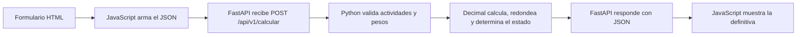

# SIGEN Lite | Guía para explicar el código

Versión de referencia `9afd1be` en `main`. Los enlaces abren la línea correspondiente en GitHub.

El recorrido principal es fácil de explicar. El formulario reúne los datos, FastAPI recibe la solicitud, los validadores comprueban las reglas y el motor calcula la definitiva. La parte que merece más práctica es la precisión decimal y el orden del redondeo. Para la primera explicación basta seguir una nota desde el botón hasta el resultado.

## Explicación de 30 segundos

> SIGEN Lite simula la nota definitiva de tres actividades. El navegador envía nombres, notas y pesos a una API. El servidor comprueba los datos, calcula el promedio ponderado con Decimal y redondea la definitiva a un decimal. El estado se decide usando esa definitiva. Separé la interfaz, la API, la validación y el cálculo para poder probar cada parte.

## Dónde se hace cada cosa

| Si te preguntan… | Abre este punto | Explicación |
|---|---|---|
| ¿Dónde se dibuja el formulario? | [`src/sigen/web/index.html:23`](https://github.com/Jacklb19/SIGEN/blob/9afd1be5d1ab2d77cde0f982dfb7278301ef3045/src/sigen/web/index.html#L23) | Hay tres grupos con nombre, nota y peso. La sección de resultado empieza en la línea 102. |
| ¿Dónde se adapta a pantallas grandes? | [`src/sigen/web/styles.css:279`](https://github.com/Jacklb19/SIGEN/blob/9afd1be5d1ab2d77cde0f982dfb7278301ef3045/src/sigen/web/styles.css#L279) | Desde 768 px, CSS organiza los campos en columnas. |
| ¿Qué ocurre al pulsar Calcular? | [`src/sigen/web/app.js:317`](https://github.com/Jacklb19/SIGEN/blob/9afd1be5d1ab2d77cde0f982dfb7278301ef3045/src/sigen/web/app.js#L317) | `calcular` prepara la solicitud con `construirCarga`, bloquea el envío duplicado y usa `fetch` para hacer el POST. |
| ¿Dónde valida el navegador? | [`src/sigen/web/app.js:155`](https://github.com/Jacklb19/SIGEN/blob/9afd1be5d1ab2d77cde0f982dfb7278301ef3045/src/sigen/web/app.js#L155) | `validarNota` revisa la precisión del texto antes de convertirlo a `Number`. La construcción del objeto `actividades` empieza en la línea 192. |
| ¿Dónde recibe FastAPI los datos? | [`src/sigen/api.py:113`](https://github.com/Jacklb19/SIGEN/blob/9afd1be5d1ab2d77cde0f982dfb7278301ef3045/src/sigen/api.py#L113) | `calcular` lee el cuerpo, decodifica los números decimales con `parse_float=Decimal` y llama a `calcular_resultado`. |
| ¿Dónde se exige que haya tres actividades? | [`src/sigen/validators.py:101`](https://github.com/Jacklb19/SIGEN/blob/9afd1be5d1ab2d77cde0f982dfb7278301ef3045/src/sigen/validators.py#L101) | `validar_entrada` revisa la estructura, la cantidad y los campos permitidos. Reúne errores y construye objetos `Actividad` cuando los datos son válidos. |
| ¿Dónde están las reglas de nota y peso? | [`src/sigen/config.py:6`](https://github.com/Jacklb19/SIGEN/blob/9afd1be5d1ab2d77cde0f982dfb7278301ef3045/src/sigen/config.py#L6) · [`src/sigen/validators.py:43`](https://github.com/Jacklb19/SIGEN/blob/9afd1be5d1ab2d77cde0f982dfb7278301ef3045/src/sigen/validators.py#L43) | Las constantes fijan los límites. `validar_nota` comprueba tipo, finitud, rango y precisión. `validar_peso` exige un entero y `validar_pesos` comprueba que la suma sea 100. |
| ¿Dónde está la fórmula? | [`src/sigen/calculator.py:16`](https://github.com/Jacklb19/SIGEN/blob/9afd1be5d1ab2d77cde0f982dfb7278301ef3045/src/sigen/calculator.py#L16) | `calcular_promedio` suma `nota × peso / 100` para cada actividad. |
| ¿Dónde se redondea y se decide si aprueba? | [`src/sigen/calculator.py:29`](https://github.com/Jacklb19/SIGEN/blob/9afd1be5d1ab2d77cde0f982dfb7278301ef3045/src/sigen/calculator.py#L29) | `calcular_resultado` redondea con `quantize` y `ROUND_HALF_UP`. `obtener_estado` compara la definitiva con 3.0. |
| ¿Dónde se arma el resultado? | [`src/sigen/domain.py:21`](https://github.com/Jacklb19/SIGEN/blob/9afd1be5d1ab2d77cde0f982dfb7278301ef3045/src/sigen/domain.py#L21) · [`src/sigen/api.py:132`](https://github.com/Jacklb19/SIGEN/blob/9afd1be5d1ab2d77cde0f982dfb7278301ef3045/src/sigen/api.py#L132) | `Resultado` reúne el promedio, la definitiva, el estado y la ponderación total. La API los devuelve como JSON. |
| ¿Dónde se muestran los datos y errores? | [`src/sigen/web/app.js:226`](https://github.com/Jacklb19/SIGEN/blob/9afd1be5d1ab2d77cde0f982dfb7278301ef3045/src/sigen/web/app.js#L226) · [`src/sigen/web/app.js:253`](https://github.com/Jacklb19/SIGEN/blob/9afd1be5d1ab2d77cde0f982dfb7278301ef3045/src/sigen/web/app.js#L253) | `mostrarResultado` escribe los datos en pantalla. `atenderErrorValidacion` usa la ruta del error para señalar el campo y `calcular` mueve el foco después de habilitarlo. |
| ¿Dónde se documenta la API? | [`src/sigen/schemas.py:19`](https://github.com/Jacklb19/SIGEN/blob/9afd1be5d1ab2d77cde0f982dfb7278301ef3045/src/sigen/schemas.py#L19) | Los esquemas de entrada, resultado y error alimentan OpenAPI. Se pueden consultar en `/docs`. |
| ¿Dónde se sirve la página y se comprueba el servidor? | [`src/sigen/api.py:84`](https://github.com/Jacklb19/SIGEN/blob/9afd1be5d1ab2d77cde0f982dfb7278301ef3045/src/sigen/api.py#L84) · [`src/sigen/api.py:141`](https://github.com/Jacklb19/SIGEN/blob/9afd1be5d1ab2d77cde0f982dfb7278301ef3045/src/sigen/api.py#L141) | `/health` confirma que la API responde. `/` sirve el HTML y `/static` sirve CSS y JavaScript. |

## Ejemplo para seguir durante la demostración

| Actividad | Nota | Peso | Aporte |
|---|---:|---:|---:|
| Parcial 1 | 3.5 | 30 % | 1.05 |
| Parcial 2 | 2.5 | 30 % | 0.75 |
| Proyecto | 4.0 | 40 % | 1.60 |

Los aportes suman 3.40. La definitiva es **3.4** y el estado es **APROBADO**. Si el profesor pregunta por el orden, usa notas `2.9 / 3.0 / 0` con pesos `50 / 50 / 0`. El promedio es 2.950 y la definitiva queda en 3.0, por eso aprueba según la regla del prototipo. Con pesos `51 / 49 / 0`, el promedio baja a 2.949 y la definitiva queda en 2.9.

## Cómo explicar las pruebas y las tecnologías

| Tema | Dónde mostrarlo | Qué decir |
|---|---|---|
| Pytest y AAA | [`tests/unit/test_calculator.py:91`](https://github.com/Jacklb19/SIGEN/blob/9afd1be5d1ab2d77cde0f982dfb7278301ef3045/tests/unit/test_calculator.py#L91) | Arrange prepara las actividades con `entrada()`, Act llama al cálculo y Assert verifica el promedio, la definitiva, el estado y el total. En este ejemplo la preparación y la llamada comparten una línea. |
| Valores límite y parametrización | [`tests/unit/test_calculator.py:26`](https://github.com/Jacklb19/SIGEN/blob/9afd1be5d1ab2d77cde0f982dfb7278301ef3045/tests/unit/test_calculator.py#L26) · [`tests/unit/test_calculator.py:99`](https://github.com/Jacklb19/SIGEN/blob/9afd1be5d1ab2d77cde0f982dfb7278301ef3045/tests/unit/test_calculator.py#L99) | Una misma prueba recibe varios datos con `parametrize`. Las fronteras incluyen 0 y 5, valores fuera de rango y promedios de 2.949, 2.950 y 2.951. |
| API y códigos HTTP | [`tests/api/test_api.py:51`](https://github.com/Jacklb19/SIGEN/blob/9afd1be5d1ab2d77cde0f982dfb7278301ef3045/tests/api/test_api.py#L51) · [`src/sigen/api.py:26`](https://github.com/Jacklb19/SIGEN/blob/9afd1be5d1ab2d77cde0f982dfb7278301ef3045/src/sigen/api.py#L26) | Un cálculo válido devuelve 200. Un campo inválido o un JSON mal formado devuelve 422. Si los campos son válidos pero los pesos no suman 100, devuelve 400. Un fallo inesperado devuelve 500 con un mensaje genérico. |
| Requests y JSON Schema | [`tests/contract/conftest.py:21`](https://github.com/Jacklb19/SIGEN/blob/9afd1be5d1ab2d77cde0f982dfb7278301ef3045/tests/contract/conftest.py#L21) · [`tests/contract/ayudas_http.py:24`](https://github.com/Jacklb19/SIGEN/blob/9afd1be5d1ab2d77cde0f982dfb7278301ef3045/tests/contract/ayudas_http.py#L24) | Con `SIGEN_URL_BASE` se usa Requests contra un servidor real. En modo interno se usa TestClient. Los esquemas independientes comprueban la forma del JSON y se complementan con pruebas de reglas como la suma de pesos. |
| Cobertura y puerta de calidad | [`scripts/verificar_calidad.py:110`](https://github.com/Jacklb19/SIGEN/blob/9afd1be5d1ab2d77cde0f982dfb7278301ef3045/scripts/verificar_calidad.py#L110) | pytest-cov genera el reporte y el script exige al menos 80 % de líneas cubiertas. Las ramas se muestran por separado. La cobertura indica qué se ejecutó. Las aserciones verifican el comportamiento. |
| Locust | [`locustfile.py:93`](https://github.com/Jacklb19/SIGEN/blob/9afd1be5d1ab2d77cde0f982dfb7278301ef3045/locustfile.py#L93) · [Reporte de carga](reporte_calidad.md#6-pruebas-de-carga) | Simula peticiones de cálculo, salud y entradas inválidas. Un 400 o 422 cuenta como correcto cuando era el resultado esperado. Se documentaron corridas con 10, 20 y 50 usuarios y su latencia. |
| GitHub Actions | [`.github/workflows/ci.yml:10`](https://github.com/Jacklb19/SIGEN/blob/9afd1be5d1ab2d77cde0f982dfb7278301ef3045/.github/workflows/ci.yml#L10) · [Ejecución final](https://github.com/Jacklb19/SIGEN/actions/runs/43158801988) | La CI instala dependencias, ejecuta Ruff y Bandit, comprueba cobertura, ejecuta regresiones de interfaz y valida Docker. Pasaron 255 pruebas Python y tres regresiones de interfaz. |
| Docker | [`Dockerfile:1`](https://github.com/Jacklb19/SIGEN/blob/9afd1be5d1ab2d77cde0f982dfb7278301ef3045/Dockerfile#L1) | La etapa base instala el paquete, la etapa `pruebas` ejecuta la suite Python y la etapa final inicia Uvicorn. |
| Observabilidad | [`src/sigen/api.py:46`](https://github.com/Jacklb19/SIGEN/blob/9afd1be5d1ab2d77cde0f982dfb7278301ef3045/src/sigen/api.py#L46) | El middleware registra método, ruta, estado y duración. Las respuestas procesadas incluyen `Server-Timing`. |
| SonarQube Cloud | [`.github/workflows/ci.yml:58`](https://github.com/Jacklb19/SIGEN/blob/9afd1be5d1ab2d77cde0f982dfb7278301ef3045/.github/workflows/ci.yml#L58) | El paso está configurado y recibe cobertura XML. El análisis depende de activar el proyecto y configurar el token en GitHub. En la CI final ese paso quedó omitido. |
| Vercel | [`src/app.py:3`](https://github.com/Jacklb19/SIGEN/blob/9afd1be5d1ab2d77cde0f982dfb7278301ef3045/src/app.py#L3) · [Guía de despliegue](despliegue_vercel.md) | La entrada exporta la aplicación FastAPI. Los archivos web se incluyen con el paquete y Python 3.12 está fijado. La verificación del servicio alojado corresponde al primer despliegue. |

## Preguntas que conviene practicar

**¿Por qué usar Decimal?** El servidor puede representar exactamente valores decimales como 0.1. Eso permite detectar precisión adicional, calcular los aportes sin redondeos intermedios y aplicar el redondeo final según la regla elegida. La API convierte los resultados a números JSON al responder.

**¿Por qué validar también en el servidor?** El navegador mejora la experiencia con mensajes inmediatos. Un cliente puede llamar directamente a la API, así que el servidor aplica todas las reglas antes de calcular.

**¿Por qué un peso de 30.0 se rechaza y una nota de 3.50 se acepta?** El peso se exige como entero JSON. La nota se comprueba por su valor, y 3.50 equivale a 3.5. El formulario aplica la regla de precisión al texto para que una conversión binaria no oculte decimales extra.

**¿Qué defecto corrigieron y cómo probaron la corrección?** Dos pruebas reprodujeron que el navegador podía aceptar una nota con precisión adicional y que el foco no volvía al campo señalado por el servidor. La reparación valida antes de convertir y mueve el foco después de habilitar los campos. Las tres regresiones pasaron tras el cambio. [Regresiones](https://github.com/Jacklb19/SIGEN/blob/9afd1be5d1ab2d77cde0f982dfb7278301ef3045/tests/ui/test_interfaz.cjs#L51) · [Historial de mantenimiento](mantenimiento.md)

**¿Dónde se guardan las notas?** La aplicación calcula cada solicitud en memoria y devuelve el resultado. El prototipo carece de base de datos y trabaja con datos de demostración.

## Orden para mostrar el código

1. Abre la interfaz y calcula con los valores iniciales.
2. Abre `app.js` en `calcular` y muestra el POST.
3. Pasa a `api.py` y señala la llamada a `calcular_resultado`.
4. Abre `validators.py` para mostrar las reglas y `calculator.py` para explicar la fórmula y el redondeo.
5. Termina con una prueba de frontera y la CI. Usa las secciones anteriores para responder preguntas específicas.
